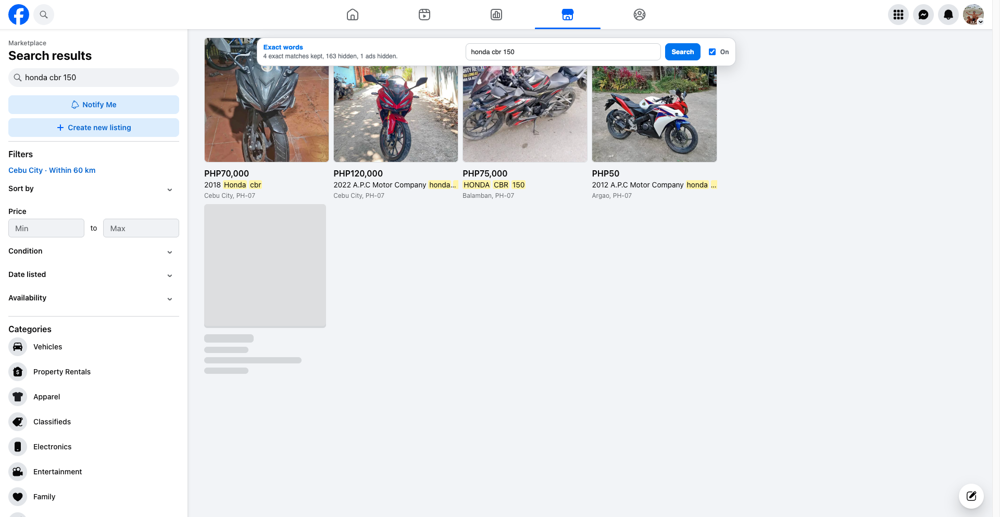

# Facebook AI Agent 2.0

Chrome extension (Manifest V3) that helps you search Facebook posts, Marketplace listings, and Marketplace inbox chats from one panel.

In v2, the toolbar icon opens a Marketplace tab and shows the agent UI in a large modal on that same page. Facebook keeps scrolling underneath while matches appear in the panel. You stay on one tab instead of bouncing between a separate extension page and Facebook.

Search `honda cbr 150` and a Honda CBR without `150`, a CBR 150 without Honda, or a CBR 250 will drop out. With Contains on, `ninja 250` also keeps `ninja z250sl`. A size like `48gb` also matches `48 GB`. Prices like `PHP250,000` do not count as a `250` match. Don't include words such as `parts, wrecked` hide those listings.



## Features

- **Live-tab agent panel**: ~90% modal with the same search UI, embedded on the Facebook tab
- **Facebook + Market list + Buying/Selling chats**: switch scopes from the top tabs
- **Same-tab search**: Enter refreshes or navigates the current Facebook tab (no extra tab spam)
- **All-word match**: every token must appear in the title, the description, or split across both
- **Don't include**: comma-separated words hide a listing if any of those words match
- **Clear params**: one click clears exclude, regex, prices, and Contains (keeps the search box)
- **Advanced filters**: optional match regex and price ranges on collected results
- **Openable results only**: empty teasers and dead item ids are dropped
- **Detail modal**: open a row for photos and description without leaving the panel
- **Contains or whole word**: Contains is on by default
- **Highlights** matching words on kept cards

## Install (unpacked)

1. Clone this repo and install dependencies:

```bash
git clone https://github.com/torrefrancae/fb-custom-strict-search-chrome-extension.git
cd fb-custom-strict-search-chrome-extension
npm install
npm run build
```

2. Open `chrome://extensions` in Chrome.
3. Turn on **Developer mode**.
4. Click **Load unpacked** and select the `dist` folder (not the repo root).
5. Click the extension icon to open the agent panel on Marketplace.

Reload the extension on `chrome://extensions` after each `npm run build`.

## How it works

1. Click the extension icon (or search from the panel). A Facebook Marketplace tab opens or refreshes.
2. The agent UI loads in a modal iframe on that tab while the page scrolls and collects results.
3. Pick Facebook, Market list, Buying chats, or Selling chats, then type a query plus optional filters.
4. Matching results render in the panel. Click a row for the detail modal.
5. Clear params resets filters without wiping the search box.

If Facebook asks you to sign in, sign in on that same tab, then search again.

## Project layout

```text
src/
  background.ts          Service worker: tab session, search relay, hunt progress
  search/                Agent UI (also embedded in the live-tab modal)
  content/               Page collectors + agent-shell overlay
  shared/                Match rules, listing extraction, settings
  popup/                 Optional launcher
scripts/build.ts         Bundles TypeScript into dist/
tests/                   Unit tests and optional live Puppeteer checks
```

## Scripts

| Command | What it does |
| --- | --- |
| `npm run build` | Bundle the extension into `dist/` |
| `npm test` | Run matcher, listing, and search-page unit tests |
| `npm run test:browser` | Puppeteer fixture plus Marketplace checks (headless) |
| `npm run test:browser -- --screenshots --html-report` | Same, with a local HTML report under `.idea/report/` |
| `npm run test:browser:headed` | Headed browser run that reuses the saved Facebook login |
| `./scripts/launch-session.sh` | Open Chrome with the persistent Facebook profile so you can log in |

### Persistent Facebook login for browser tests

Live Marketplace checks need a logged-in Facebook session. That profile is stored locally at:

```text
.idea/chrome-session/
```

It is gitignored. Sign in once into **this** profile (not your everyday Chrome). Tests look for the Facebook `c_user` cookie before treating the session as logged in.

**First-time login (pick one):**

```bash
# Option A: open the persistent profile and log in manually
npm run build
./scripts/launch-session.sh
# Log in to Facebook Marketplace in the window that opens.
# Quit that Chrome fully when Marketplace shows you signed in (cookies flush on quit).

# Option B: let the headed test open Chrome and wait for you
npm run build
npm run test:browser:headed
# When the console says to log in, finish Facebook login in the opened window.
# Wait until Marketplace is signed in; the runner requires the c_user cookie.
```

**Later runs (already logged in):**

Only one Chrome can use `.idea/chrome-session` at a time. Quit `launch-session` first if it is still open, then:

```bash
npm run build
npm run test:browser -- --screenshots --html-report
# or keep watching the browser:
npm run test:browser:headed
```

Optional attach-style session probe (uses the same profile via debugging port 9333):

```bash
./scripts/launch-session.sh
npm run test:session -- --query="honda cbr 150" --screenshots --html-report
```

HTML reports land in `.idea/report/` (also gitignored). Open `smart-search-browser-test.html` after a screenshot run.

## Tests

```bash
npm test
```

The matcher tests cover:

- words in any order
- words split across title and description
- title-only and description-only hits
- a missing word (listing is dropped)
- comma-separated Don't include words that hide a listing
- substring hits such as `ninja 250` inside `ninja z250sl`
- exact mode so `civic` does not match `civics`
- prices so `PHP250,000` is not treated as a `250` model match

## Privacy

- Runs locally in your browser
- Stores substring vs exact, Don't include words, and the last search in `chrome.storage.local`
- Does not send listing data to a third-party server

## License

MIT
